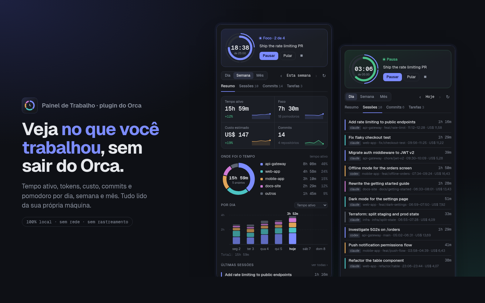

# Painel de Trabalho (Work Dashboard) for Orca



A sidebar panel for [Orca](https://onorca.dev) that shows **what you worked on** by day, week and month:

- **Active time** of your coding agents, without double counting agents that run in parallel, compared with the previous period
- **Where the time went**, project by project (worktrees count toward their main repository)
- **Tokens and estimated cost** for Claude Code and Codex, per project and per model
- **Sessions**: title, project, branch, time and cost of each one
- **Your commits** across every repository in the folders you choose
- **Pomodoro** in the panel and in Orca's status bar, with a desktop notification at the end of each focus and break
- **To-do list**: tasks you complete show up in the period's report

The interface is in Portuguese (pt-BR) for now.

## Privacy

Everything stays on your machine. The plugin has **no network access, no analytics and no tracking**.

| What it reads | Where |
| --- | --- |
| Claude Code transcripts | `~/.claude/projects/**/*.jsonl` (read-only) |
| Codex sessions | `~/.codex/sessions/**/*.jsonl` (read-only) |
| Your commits | `git log` in the repositories under the folders you configure (default `~/dev`), read-only |

| What it writes | Where |
| --- | --- |
| A cache of the data above, so later reads are fast and history survives when Claude Code deletes old transcripts | `~/.cache/orca-painel/` (readable only by your user) |
| Pomodoros, tasks and settings | Orca's own storage for this plugin |

Git runs read-only: no repository locks, hooks or fsmonitor. Delete `~/.cache/orca-painel/` at any time to clear the cache.

The cost is an **estimate** at Anthropic API prices. On a subscription plan (Pro/Max) you don't pay per token. Codex shows tokens only.

## Install

From Orca: **Settings → Plugins → Add plugin**, then the Git option, with this repository's URL. Or from a terminal:

```sh
orca plugin install DiegoHonorio/orca-painel
```

Orca asks you to approve it, because it runs its own code (to read the files above).

## Settings

**Settings → Plugins → Painel de Trabalho**: pomodoro length, the Claude Code, Codex and repository folders, and your commit e-mail addresses (empty means `git config user.email`).

## Development

```sh
orca plugin validate .
orca plugin dev watch .     # loads this folder into Orca and reloads on save
```

| Path | What it is |
| --- | --- |
| `src/worker.ts` | Plugin process: pomodoro, tasks, answers to the panel |
| `src/coleta/` | Reading Claude Code, Codex and git, plus the price table |
| `src/relatorio.ts` | Aggregation per period |
| `src/protocol.ts` | Contract between panel and worker |
| `panel/` | The panel (HTML, CSS and JS, no build step) |
| `tools/demo/` | Demo page with made-up data, used for the screenshots |
| `tools/prints.sh` | Regenerates `media/` from the demo page (never from your real data) |

---

## Em português

Painel para o Orca que mostra no que você trabalhou por dia, semana e mês: tempo ativo dos agentes, onde foi o tempo por projeto, tokens e custo estimado do Claude Code e do Codex, sessões, commits, pomodoro e tarefas.

**Privacidade:** tudo fica na sua máquina. O plugin não acessa a rede e não coleta nada. Ele só lê as transcrições do Claude Code e do Codex e roda `git log` em modo só leitura. O cache fica em `~/.cache/orca-painel/`, legível só pelo seu usuário.

O custo é uma estimativa pelos preços da API. No plano de assinatura você não paga por token.

## License

[MIT](LICENSE)
